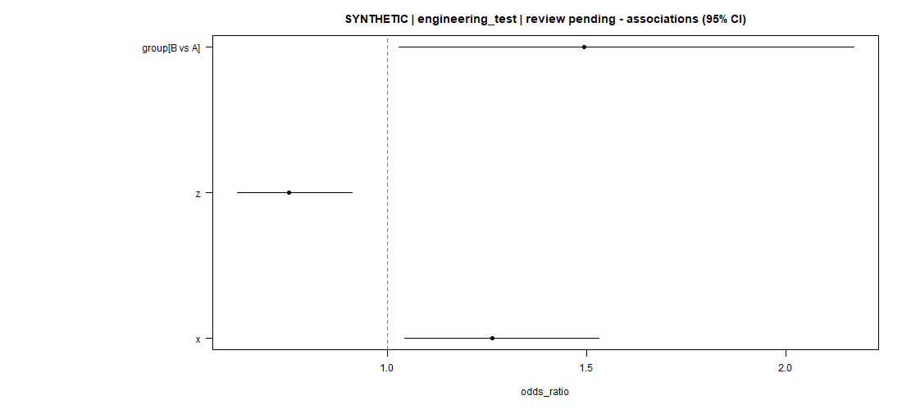
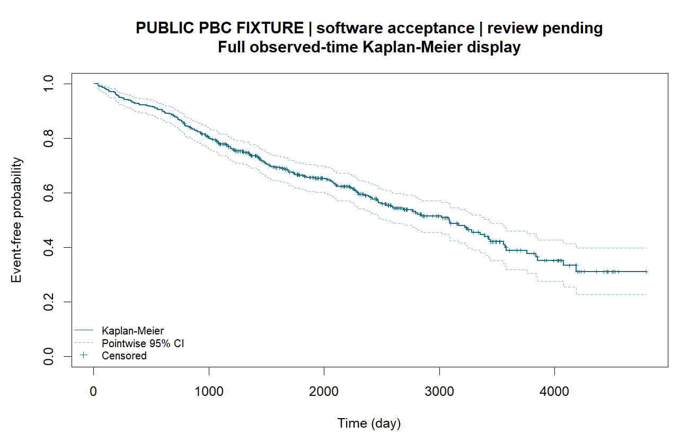

# Ye1 临床分析 Skill

## 安装到你的 Agent

适用于 **Windows x64 或 Apple 芯片 Mac + Codex**。在 Codex 中打开你的研究项目，把下面整段发给 Agent：

```text
请先识别我的系统，从 GitHub 仓库 Nzjye1/ye1-clinical-research-skill 获取适用的 Ye1 临床分析 Skill 客户包，安装到我当前打开的研究项目。
请先阅读包内安装说明，检查并准备所需依赖，完成安装和基础自检。
完成后告诉我安装的版本、是否成功，以及如何开始使用。
```

[下载 Windows 客户包](https://github.com/Nzjye1/ye1-clinical-research-skill/releases/download/v0.3.2/ye1-clinical-client-0.3.2-windows-local-noninteractive1-72d31b8c.zip) · [源码包](https://github.com/Nzjye1/ye1-clinical-research-skill/releases/download/v0.3.2/ye1-clinical-source-0.3.2-windows-local-noninteractive1-72d31b8c.zip) · [SHA256](https://github.com/Nzjye1/ye1-clinical-research-skill/releases/download/v0.3.2/SHA256SUMS.txt) · [详细安装、环境与恢复说明](docs/showcase/INSTALL.md)

[Apple 芯片 Mac 联网安装包](https://github.com/Nzjye1/ye1-clinical-research-skill/releases/download/v0.3.2/ye1-clinical-0.3.2-macos-arm64-online-72d31b8c.zip) · [Mac 离线包](https://github.com/Nzjye1/ye1-clinical-research-skill/releases/download/v0.3.2/ye1-clinical-0.3.2-macos-arm64-offline-72d31b8c.zip) · [Mac 安装说明](macos/INSTALL.md)

<p align="center">
  
</p>

**提供本地 CSV 和研究问题，让 Agent 帮你完成统计分析、结果表图与说明。免费使用，自有代码采用 MIT 许可。**

面向医生与临床科研团队，在 Windows x64 或 Apple 芯片 Mac 的 Codex 中使用。已有数据，需要基线描述、关联分析、生存分析、预测建模、匹配或纵向分析时，可以从统一入口选择方法，也可以独立调用单项 Skill。

[具体功能](#具体能做什么) · [输入材料](#需要提供什么) · [分析成果](#实际分析产物) · [安装说明](docs/showcase/INSTALL.md) · [联系反馈](#联系与反馈)

## 具体能做什么

| 分析方向 | 已有功能 | 典型成果 |
|---|---|---|
| 基线与组间比较 | 总体 / 分组描述；Welch t、配对 t、Wilcoxon、卡方、Fisher 检验 | 基线表、分母与缺失说明、比较结果 |
| 关联分析 | OLS、Logistic、预设调整模型、固定结点 RCS、亚组交互与敏感性分析 | 效应量、95% CI、效应图与模型说明 |
| 生存分析 | 右删失 KM、Cox 关联及相应 PH 诊断 | KM 曲线、风险集、HR 表与诊断说明 |
| 预测与评价 | Ridge / LASSO / Elastic Net、二分类随机森林 / HGB、普通及惩罚 Cox；冻结模型推断与适用评价 | 模型、结果表，以及适用的 ROC、校准、DCA、贡献图或列线图 |
| 匹配与中介 | 1:1 PSM 后连续 / 二分类 / 生存结局分析，限定线性中介 | 平衡与效应结果、中介估计及区间 |
| 聚类与纵向 | KMeans、Gaussian mixture、限定 Gaussian LPA / LCGA、增长混合与普通混合增长模型 | 类别特征、轨迹图、模型与赋类结果 |
| 样本量与精度 | 均值 / 比例估计精度、独立两组均值差 / 比例差规划 | 样本量与所用假设 |

已有 **33 个原生数值后端、8 个共享后端别名、11 个结果视图、5 项基础检验和 4 项规划操作**。按研究问题、结局和数据条件选择方法；已有结果视图可单独导出。

## 需要提供什么

- **研究问题：** 想比较什么，结局是什么，希望回答什么。
- **本地 CSV：** 文件位置、研究单位、分组和参考组。
- **变量定义：** 列名、单位、编码、缺失约定及可知时间。
- **生存任务：** 时间起点、时间单位、事件码和删失含义。
- **已有模型任务：** 相应模型、训练定义与版本材料。

Agent 核对输入和所选方法后调用本地分析，成果写入独立新目录。

## 能得到什么

**结果表、适用图件和结果说明。** 按任务输出样本流与分母、估计量和置信区间、方法参数、模型或冻结结果，以及基线图、效应图、KM、ROC、校准、DCA、贡献图或轨迹图等。

## 实际分析产物

### Logistic 关联：合成示例

分析模块实际生成的 Logistic 效应图，使用**合成示例数据**，展示效应量与 95% CI。



### 公开 PBC：首次死亡或肝移植

使用 R `survival` 包的公开 PBC 数据，以登记日为时间起点、首次死亡或肝移植为复合事件，生成 KM 曲线、95% CI 与删失标记。



[查看案例与来源](docs/showcase/CASES.md)

## 开始分析

安装并自检后，在研究项目使用 `$ye1-clinical-analysis`，提供本地文件位置、研究问题与变量定义；也可调用 `$ye1-association-logistic` 等单项入口。

可以这样开始：

> 请使用 Ye1 临床分析。我的 CSV 在本地：[文件位置]。研究问题是：[问题]；结局、分组及参考组是：[定义]；变量字典是：[列名、单位、编码与缺失约定]。请先核对方法，再生成统计表图与结果说明，写入新目录。

## 联系与反馈

微信：**`ye1aikeyan`** · 邮箱：[ye1aikeyan@163.com](mailto:ye1aikeyan@163.com)

反馈时提供版本、系统和脱敏问题摘要；患者行、标识及本地日志留在本地。

自有代码采用 [MIT 许可](LICENSE)，第三方组件保留各自许可与原声明。见[许可与来源](docs/RIGHTS.md)。
