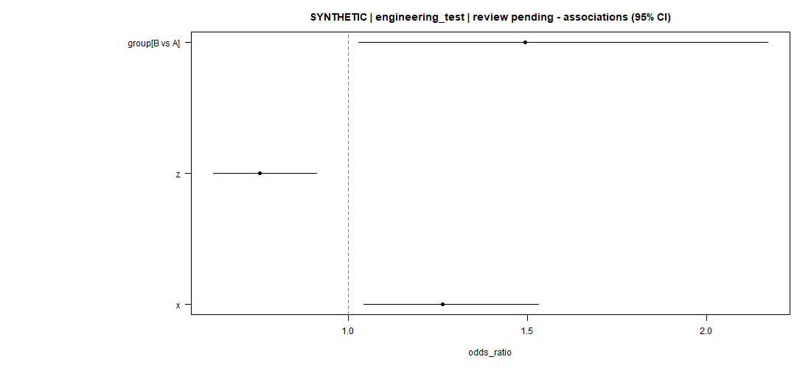
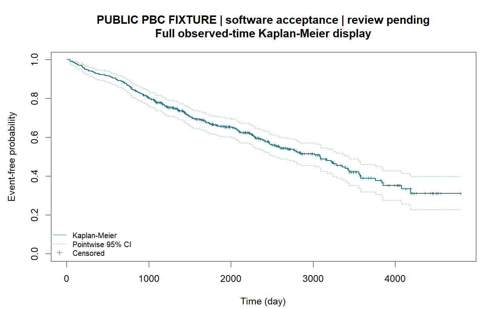

# Ye1 临床分析：实际表图

[返回产品主页](../../README.md) · [安装说明](INSTALL.md)

## Logistic 关联：合成示例

使用合成示例数据运行二分类 Logistic 关联分析，输出效应量、95% CI 和结果说明。下图为分析模块实际生成的效应图，保留原图标签。

## 公开 PBC：首次死亡或肝移植

使用 R `survival` 3.8-6 包的公开 `pbc` 数据，共 418 条研究记录。时间从登记日起算，单位为天；status=1（移植）或 2（死亡）为首次复合事件，status=0 为右删失。事件 186、删失 232。

输出 KM 曲线、95% CI、删失标记与相应数值表。时间、风险集、事件未发生概率和区间与独立 `survival::survfit` 参考计算比较，404 个时点、1212 个概率及区间数值的最大绝对差为 `8.881784197001252e-16`。案例展示该复合事件定义下的单组曲线。

来源：[survival / CRAN](https://cran.r-project.org/package=survival)，维护者 Terry M. Therneau，包许可 LGPL (>= 2)。本页提供聚合图与案例说明。
